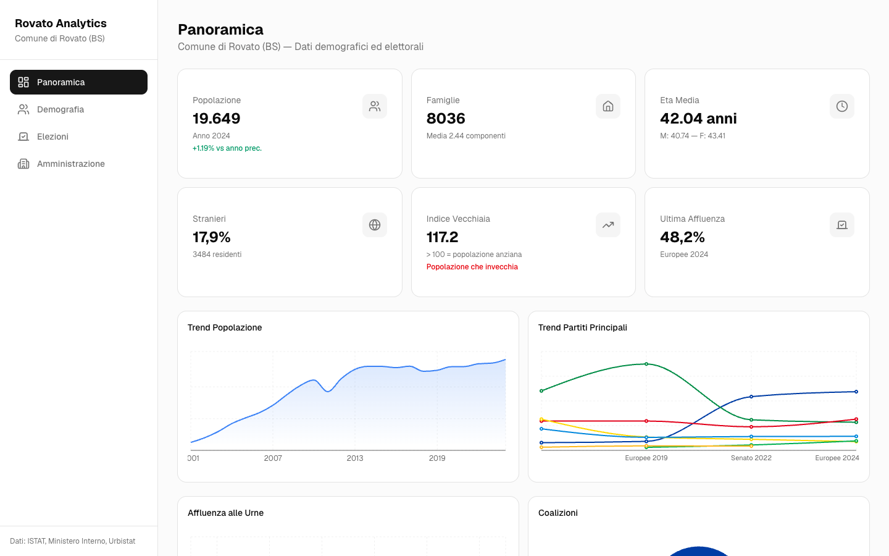
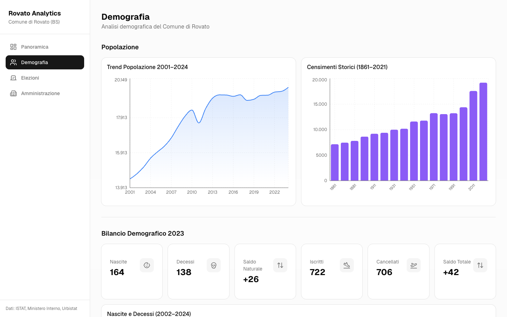
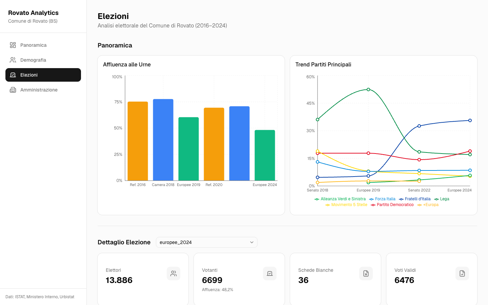

# Rovato Analytics

Dashboard analitica per il Comune di Rovato (BS): dati demografici, elettorali e amministrativi raccolti in un'unica interfaccia, consultabile anche da mobile.



## Cosa mostra

La dashboard è divisa in quattro sezioni, raggiungibili dalla barra laterale.

### Panoramica

- Indicatori principali: popolazione, famiglie, età media (con dettaglio maschi e femmine), percentuale di stranieri residenti, indice di vecchiaia e affluenza all'ultima consultazione.
- Grafici sintetici su andamento della popolazione, trend dei partiti principali, affluenza alle urne e coalizioni alle comunali 2020.

### Demografia



- **Popolazione**: andamento 2001-2024 e censimenti storici dal 1861 al 2021.
- **Bilancio demografico 2023**: nascite, decessi, saldo naturale, iscritti, cancellati e saldo totale, più la serie storica di nascite e decessi (2002-2024).
- **Struttura per età**: distribuzione per fascia d'età, struttura per età nel tempo e andamento degli indici demografici.
- **Famiglie e stato civile**: trend del numero di famiglie (2018-2023) e composizione per stato civile.
- **Stranieri residenti**: totale, ripartizione per sesso e principali nazionalità.

### Elezioni



Copre nove consultazioni tra il 2016 e il 2024: referendum costituzionali 2016 e 2020, politiche 2018 e 2022 (Camera e Senato), europee 2019 e 2024, comunali 2020.

- **Panoramica**: affluenza per consultazione e andamento dei partiti principali nel tempo.
- **Dettaglio elezione**, con selettore della consultazione:
  - elettori, votanti, affluenza, schede bianche e voti validi;
  - risultati per lista e, dove presenti, per coalizione;
  - candidati all'uninominale (politiche 2022, Camera);
  - per politiche 2018 e 2022 e comunali 2020: mappa delle 15 sezioni elettorali e tabella di dettaglio per sezione.

### Amministrazione

- Avanzamento del mandato 2020-2025.
- Scheda del sindaco, composizione della giunta (assessori) e del consiglio comunale, con lista di appartenenza, ruolo e titolo di studio.

## Fonte dei dati

Tutti i dati vengono da un unico dataset statico, [`public/rovato_mega_dataset.json`](public/rovato_mega_dataset.json), importato a build time da [`lib/data.ts`](lib/data.ts). Non ci sono chiamate ad API esterne né database.

Le fonti dichiarate nel dataset sono:

- ISTAT
- Urbistat
- tuttitalia.it
- Ministero dell'Interno (Eligendo)
- Comune di Rovato

Il dataset è stato generato il 27 marzo 2026 (campo `generated_at`). Per aggiornare i numeri basta sostituire il file JSON mantenendo la stessa struttura: i tipi TypeScript sono derivati direttamente dal JSON.

## Stack

- [Next.js](https://nextjs.org) 16 (App Router, pagine generate staticamente)
- React 19 e TypeScript
- [Tailwind CSS](https://tailwindcss.com) 4
- Componenti UI in stile [shadcn/ui](https://ui.shadcn.com) su [Base UI](https://base-ui.com)
- [Recharts](https://recharts.org) per i grafici
- [Lucide](https://lucide.dev) per le icone

## Struttura

```
app/
  page.tsx                  Panoramica
  demografia/page.tsx       Sezione Demografia
  elezioni/page.tsx         Sezione Elezioni
  amministrazione/page.tsx  Sezione Amministrazione
  layout.tsx                Layout con sidebar e navigazione mobile
components/
  charts/                   Un componente per ogni grafico o tabella
  layout/sidebar.tsx        Navigazione
  kpi-card.tsx              Card degli indicatori
  ui/                       Componenti di base (card, tabelle, select, ...)
lib/
  data.ts                   Import del dataset, tipi e funzioni di formattazione
public/
  rovato_mega_dataset.json  Dataset
docs/                       Screenshot usati in questo README
```

## Avvio in locale

Serve Node.js 20.9 o superiore e [pnpm](https://pnpm.io) 11 (la versione esatta è indicata nel campo `packageManager` di `package.json`, quindi con Corepack attivo viene selezionata in automatico).

```bash
pnpm install
pnpm dev
```

La dashboard è disponibile su [http://localhost:3000](http://localhost:3000).

Per la build di produzione:

```bash
pnpm build
pnpm start
```

Durante `pnpm install` pnpm segnala che alcuni script di build delle dipendenze (per esempio `sharp`) non sono stati eseguiti. È solo un avviso: l'installazione è completa e la build funziona.

Altri comandi:

```bash
pnpm lint   # ESLint
```
